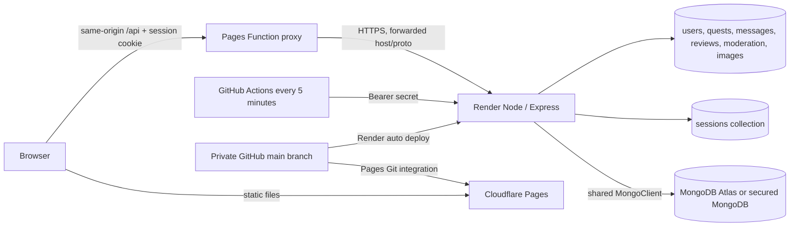

# SideQuest deployment guide

This setup uses Cloudflare Pages for the Vite frontend, a Node.js web service for Express, and MongoDB Atlas (or another secured hosted MongoDB replica set). Cloudflare Pages forwards `/api/*` through a Pages Function so browser requests and session cookies stay on the Pages origin.

## Audit findings

- The repository is split into `frontend/` and `backend/`; each has its own `package.json` and lockfile. Build the frontend with `npm ci && npm run build` from `frontend/`. Start Express with `npm start` from `backend/`.
- Node.js 22.12 or newer in the 22.x line is pinned through package engine declarations and the Render blueprint.
- The current `backend/.env` points at `127.0.0.1`; that is a local Docker MongoDB replica set, not a hosted database. The backend uses the `sidequest` database. No hosted MongoDB URI or deployment credentials are configured in the repository.
- The API uses Express, Passport, Argon2, `sharp`, the MongoDB Node driver and multi-document transactions. It is a Node service, not a Cloudflare Workers application. Use the Cloudflare Function only as an HTTP proxy; do not port the API runtime to Workers without a separate migration.
- Sessions are stored in MongoDB's `sessions` collection using the same MongoClient as application data. The session cookie is HTTP-only, `SameSite=Lax`, and `Secure` in production. Express trusts the one Cloudflare-to-Render proxy hop so HTTPS and the public host are recognized.
- Quest images and completion receipt images are sanitized and stored in MongoDB, not on the server filesystem. They survive redeploys with the database. No R2 bucket is needed for the current implementation.
- `docker-compose.yml` is local-development MongoDB only. There was no production Dockerfile, Cloudflare configuration, Render blueprint, or scheduled GitHub workflow before this deployment setup.
- The backend previously listened on a fixed port and used a one-minute in-process background timer. It now honors `PORT`; production lifecycle/review/image-cleanup jobs are invoked by an authenticated GitHub Actions schedule. The local timer remains enabled only outside production.
- Git remote is the private-capable `appdev-at-mit/sidequest` repository and the current branch is `main`. Cloudflare/Render GitHub authorization is account-level and must be completed in their dashboards.
- `.gitignore` had unresolved conflict markers; it has been replaced with a valid ignore file. `backend/.env` is currently tracked in the existing Git index. The sandbox made the `.git` index read-only, so I could not remove it from tracking here. **Before committing deployment changes**, run `git rm --cached backend/.env` (keeps the local file) and verify `git status`; `.gitignore` alone does not untrack an already tracked file. The currently visible file uses a local Mongo URL and a development placeholder, but do not put real secrets in it.

## Architecture

## Environment variables

Templates are in `backend/.env.example` and `frontend/.env.example`. Local or hosted `.env` files are private and ignored; do not commit them.

| Variable | Where | Purpose |
| --- | --- | --- |
| `NODE_ENV` | Express host | Set `production` when hosted. |
| `PORT` | Express host | Supplied by the host; Render blueprint uses `10000`. |
| `MONGODB_URI` | Express host only | TLS MongoDB connection string. Never put in a `VITE_` variable. |
| `MONGODB_DB_NAME` | Express host | Database name; use `sidequest` unless intentionally selecting another database. |
| `SESSION_SECRET` | Express host only | Random secret of at least 32 characters. `SECRET` remains accepted for existing local setups. |
| `APP_BASE_URL` | Express host | Exact HTTPS Cloudflare Pages production origin, for write-origin checks. |
| `BACKGROUND_JOB_SECRET` | Express host only | Random bearer secret used only by the scheduled job endpoint. |
| `SIDEQUEST_BACKEND_URL` | GitHub Actions repository variable | Render API origin, e.g. `https://<service>.onrender.com` (no `/api`). |
| `SIDEQUEST_BACKGROUND_JOB_SECRET` | GitHub Actions repository secret | Must exactly match `BACKGROUND_JOB_SECRET`. |
| `BACKEND_ORIGIN` | Cloudflare Pages environment variable | HTTPS Render origin used by the `/api/*` proxy. |
| `VITE_API_BASE_URL` | Frontend build-time only | Leave empty with the Pages proxy. It is public if set and must never contain credentials. |
| `VITE_API_PROXY_TARGET` | Local Vite only | Optional local Express proxy target; defaults to `http://127.0.0.1:3000`. |
| `ADMIN_KERBS`, `MODERATOR_KERBS` | Express host only | Optional comma-separated moderator allowlists. |
| `MAX_IMAGE_BYTES`, `MAX_IMAGE_WIDTH`, `MAX_IMAGE_HEIGHT`, `MAX_IMAGE_PIXELS`, `MAX_CONCURRENT_IMAGE_UPLOADS` | Express host only | Upload validation/resource limits. |
| `MAX_USER_IMAGE_STORAGE_BYTES`, `MAX_GLOBAL_IMAGE_STORAGE_BYTES` | Express host only | Database-backed image storage quotas. |
| `MAX_QUEST_REWARD_CENTS` | Express host only | Maximum allowed quest reward in cents. |
| `PHOTON_API_URL` | Express host (optional) | Address geocoder override. Defaults to the existing Photon endpoint. |

Separate Cloudflare Pages Preview and Production bindings and Render Preview/Staging and Production environment groups if you create those environments. Use a separate database and secrets in staging; do not point staging at production data. The files here provide the production blueprint and safe local templates, not actual credentials.

## Deploy the backend (Render)

1. In Render, choose **New → Blueprint** and connect the private `appdev-at-mit/side-quest` repository. Authorize access to this repository only if desired.
2. Select the `main` branch and review `render.yaml`. It builds both lockfile-backed packages and starts `backend/api.js` from the backend directory. `autoDeploy: true` deploys later pushes to `main`.
3. The checked-in blueprint uses Render's **Free** plan and honors the no-purchase requirement. Free web services can spin down after 15 minutes idle and may take about a minute to wake. Render says free instances are for previews/hobby projects, not production. Upgrade only after approving the cost; the current smallest always-on compute is listed at $7/month, subject to change.
4. In the service's **Environment** settings, enter:
   - `MONGODB_URI`: the hosted replica-set URI from the MongoDB instructions below.
   - `MONGODB_DB_NAME`: `sidequest`.
   - `SESSION_SECRET`: a newly generated random value (32+ characters; do not reuse the local placeholder).
   - `APP_BASE_URL`: the Cloudflare production origin, e.g. `https://<project>.pages.dev`; initially set this after creating the Pages project, then redeploy.
   - `BACKGROUND_JOB_SECRET`: a different random value from `SESSION_SECRET`.
   - `ADMIN_KERBS` or `MODERATOR_KERBS` only if moderation access is not assigned in the user data.
5. Confirm the Render service reaches `/health/ready` with HTTP 200. It returns only readiness flags and missing variable names, not connection details.

The current free Render instance is deliberately a low-cost preview configuration. Its ephemeral filesystem is harmless for images because images live in MongoDB. It does sleep, however; use an always-on plan for production responsiveness and dependable operations.

## Connect MongoDB

1. In MongoDB Atlas, use an existing cluster if it is already intended for SideQuest. Otherwise create an Atlas cluster and database user. The app database name is `sidequest`; its collections and indexes are initialized by the server without dropping existing records.
2. In **Security → Network Access**, allow only the outbound IP addresses shown for the Render service/region (or the exact egress ranges supplied by the hosting provider). Do not use `0.0.0.0/0` as a convenience.
3. In **Database → Connect → Drivers**, copy the Node.js connection string. Replace the placeholder username/password in the Atlas dashboard flow, then save the resulting URI only in Render's `MONGODB_URI` environment variable. Never add it to Cloudflare Pages or frontend build settings.
4. Set `MONGODB_DB_NAME=sidequest` in Render. The API's data collections and `sessions` collection use this same database and shared MongoClient.
5. Do not copy local data into Atlas automatically. If local development records are needed, plan and approve a separate backup/export/import; no migration is performed by this deployment setup.

Atlas M0 currently provides 512 MB at no charge and is suitable for prototyping. SideQuest stores image bytes in MongoDB, so monitor capacity; consider external object storage only if needed and after approving its cost. Existing upload limits do not imply a larger Atlas quota.

## Deploy the frontend (Cloudflare Pages)

1. In Cloudflare, open **Workers & Pages → Create application → Pages → Connect to Git**. Authorize the Cloudflare GitHub application for the private `appdev-at-mit/side-quest` repo.
2. Select production branch `main` and configure:
   - Root directory: `frontend`
   - Build command: `npm ci && npm run build`
   - Build output directory: `dist`
   - Node version: `22.15.0` (set `NODE_VERSION` in build variables if Cloudflare does not select it automatically).
3. In the Pages project's **Settings → Variables and Secrets → Production**, set `BACKEND_ORIGIN` to the HTTPS Render service origin (for example `https://sidequest-api.onrender.com`, without a trailing path). Set the same binding for Preview only if preview pages are intended to access a non-production backend; otherwise do not expose production data to previews.
4. Keep `VITE_API_BASE_URL` unset/empty. The committed `frontend/functions/api/[[path]].js` forwards `/api/*`, preserves browser cookies, and adds trusted forwarded host/protocol headers for Express. Do not add a permissive CORS policy.
5. Once Pages supplies its `*.pages.dev` origin, set the exact origin as Render's `APP_BASE_URL`, save, and redeploy the backend. Add a custom domain later through Cloudflare Pages if desired; update `APP_BASE_URL` to that exact origin.
6. Verify `/health/ready` on the Render origin and test the Pages `/api/auth-status` request in the browser. The latter should reach the backend through the same-origin proxy.

Cloudflare Pages supports Git-based deployments and private GitHub repository authorization. Static asset requests are free; Pages Function requests count against Workers quotas. The current free Workers quota is 100,000 requests/day. Check the current account dashboard before enabling paid usage.

## GitHub deployment and scheduled jobs

- Cloudflare Pages Git integration builds and deploys `main` automatically and provides branch/PR preview deployments. The repository must stay private; do not switch to Direct Upload.
- Render's blueprint auto-deploys `main`. Authorize Render's GitHub app for the repository in Render's dashboard.
- In GitHub **Settings → Secrets and variables → Actions**, create repository variable `SIDEQUEST_BACKEND_URL` with the Render origin and secret `SIDEQUEST_BACKGROUND_JOB_SECRET` matching Render's `BACKGROUND_JOB_SECRET`.
- `.github/workflows/background-jobs.yml` runs `POST /api/internal/background-jobs` every five minutes and supports manual dispatch. The endpoint requires a constant-time checked bearer token. Jobs process persisted quest deadlines, review publication/reminders, and unattached-image cleanup using existing idempotent database routines.
- GitHub scheduled workflows can be delayed and are not a precise scheduler. The five-minute cadence is appropriate for deadline/archive/reminder housekeeping but is not a real-time guarantee. Confirm the workflow is enabled on `main` and inspect its run history.

## Health, logs, and troubleshooting

- `GET /health/live`: process liveness only.
- `GET /health/ready`: database ping, session-store configuration, required production settings, and background-job configuration. It returns 503 until required checks pass.
- Render logs report API startup and job failures without returning stack traces or secrets to callers.
- If readiness reports `MONGODB_URI`, `SESSION_SECRET`, `APP_BASE_URL`, or `BACKGROUND_JOB_SECRET` missing, add it to Render and redeploy.
- If the database check fails, confirm the URI, database user/password URL encoding, Atlas network allowlist, TLS connection, and `sidequest` database selection.
- If writes return origin errors, ensure `APP_BASE_URL` exactly matches the visible Pages/custom-domain origin and redeploy.
- If login returns 401 repeatedly or refresh loses the session, inspect the Pages proxy for `Set-Cookie` and Cookie forwarding, `APP_BASE_URL`, HTTPS, and Render's proxy trust. Do not weaken `Secure`, `HttpOnly`, or `SameSite` settings.
- If `/api/*` responds with a Pages 503, set `BACKEND_ORIGIN` in Pages Production bindings and redeploy.
- Cloudflare Workers does not run this Express backend. Its current auth, native modules, and Mongo transaction workflows stay in the Node service.

## Deployment verification status

The repository configuration is prepared, but no external account authorization, hosted environment variables, hosted MongoDB URI, or actual production deployment was available during this audit. Therefore hosted registration/login, session persistence, quest lifecycle, messages, image upload, moderator permissions, persistence across service restarts, and GitHub-triggered deployments remain **unverified** until the dashboard steps above are completed. Do not treat a local build or a working Cloudflare static page as proof the API or database is online.

After deployment, verify with a dedicated test account and a disposable staging database: register/log in, refresh and confirm the session, create and accept a quest, exchange a message, upload/read an authorized image, confirm moderator-only routes reject ordinary users, restart/redeploy and confirm records/images remain, then dispatch the scheduled workflow and confirm its JSON counts and successful history. Do not perform these writes against existing production data without an approved test plan.

## Cost snapshot

Indicative current US starting costs, not a quote:

| Service | Lowest configured cost | Caveat |
| --- | ---: | --- |
| Cloudflare Pages static hosting | $0 | Pages Functions consume Workers request quota. |
| Workers/Pages Functions free tier | $0 | 100,000 requests/day; over-quota requests fail on Free. |
| Render Free web service | $0 | Sleeps after 15 minutes idle, may restart, and is not recommended for production. |
| MongoDB Atlas M0 | $0 | 512 MB total; images share this capacity. |
| GitHub Actions scheduled workflow | Typically within included usage | GitHub usage/limits depend on account and repository settings; scheduled runs may be delayed. |

Thus the preview configuration can be $0/month, subject to account quotas. Render's current always-on smallest compute is $7/month; Atlas Flex is usage-based ($0.011/hour, up to $30/month in MongoDB's estimate) and dedicated Atlas starts around $56.94/month on its current pricing page. No paid services are provisioned by this repository. Verify prices and quota terms before upgrading.

## Local development

1. Use Node.js 22.12+ (22.x), Docker, and `docker compose up -d --wait` for the local Mongo replica set.
2. Copy `backend/.env.example` to `backend/.env`; use a local-only `SESSION_SECRET` with 32+ random characters. Keep the local Mongo URI pointed at `127.0.0.1`.
3. In one terminal: `cd backend; npm ci; npm start`.
4. In another: `cd frontend; npm ci; npm run dev`.
5. Vite proxies `/api` to `http://127.0.0.1:3000`; set `VITE_API_PROXY_TARGET` to override locally. Never use local `.env` values for hosted secrets.
